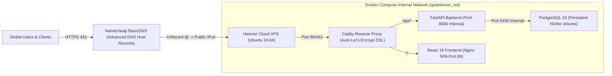

# QubeLancer — Hetzner Cloud & Namecheap Production Deployment Runbook

**Application:** QubeLancer (Global Professional Services & Autonomous Marketplace)  
**Infrastructure Target:** Hetzner Cloud Server (Ubuntu 24.04 LTS x64)  
**Domain Registrar & DNS:** Namecheap (namecheap.com)  
**Ingress & Security:** Caddy Server 2 (Automated TLS via Let's Encrypt / ZeroSSL)  
**Application Stack:** Docker Compose (React 19 SPA + FastAPI + PostgreSQL 16)  

---

## 1. Architecture Overview



---

## 2. Phase 1: Provisioning Hetzner Cloud Server

### Step 1.1: Log in to Hetzner Cloud Console
1. Navigate to [https://console.hetzner.cloud/](https://console.hetzner.cloud/) and log in with your client's credentials.
2. Click **New Project** and name it `QubeLancer`.

### Step 1.2: Add SSH Key (Recommended)
1. In the project sidebar, go to **Security** $\rightarrow$ **SSH Keys**.
2. Click **Add SSH Key** and paste your public key (`id_ed25519.pub` or `id_rsa.pub`).

### Step 1.3: Create Server
1. Click **Add Server**.
2. **Location:** Select the datacenter closest to your primary target market:
   - Germany: **Nuremberg (nbg1)** or **Falkenstein (fsn1)**
   - Finland: **Helsinki (hel1)**
   - USA: **Ashburn, VA (ash)** (Recommended if targeting North American clients)
3. **Image:** Choose **Ubuntu 24.04 LTS**.
4. **Type:** Select **Shared vCPU (x86)**:
   - **CX22** (2 vCPU, 4 GB RAM, 40 GB NVMe SSD) ~€3.79/month — *Ideal for launch & MVP*
   - **CPX21** (3 vCPU, 4 GB RAM, 80 GB NVMe SSD) ~€7.05/month — *Recommended for production growth*
5. **Networking:** Keep Public IPv4 and IPv6 enabled.
6. **SSH Key:** Select the SSH key added in Step 1.2.
7. **Name:** Name your server `qubelancer-prod-01`.
8. Click **Create & Buy Now**.
9. **Important:** Copy the **Public IPv4 address** assigned to the server (e.g. `159.69.xxx.xxx`).

### Step 1.4: Configure Hetzner Cloud Firewall
1. In the Hetzner console, navigate to **Firewalls** $\rightarrow$ **Create Firewall**.
2. Name it `qubelancer-firewall`.
3. Add the following **Inbound Rules**:
   - `TCP` / `Port 22` / `Source: Any IPv4 & IPv6` (Or restricted to your IP)
   - `TCP` / `Port 80` / `Source: Any IPv4 & IPv6` (HTTP for Let's Encrypt challenge & redirect)
   - `TCP` / `Port 443` / `Source: Any IPv4 & IPv6` (HTTPS for live encrypted traffic)
4. Leave **Outbound Rules** as default (Allow all).
5. Under **Apply to**, attach it to `qubelancer-prod-01`.

---

## 3. Phase 2: Namecheap DNS Configuration

Configure your domain in **Namecheap** to point to your Hetzner Cloud server.

### Step 2.1: Log in to Namecheap & Open Domain List
1. Go to [https://ap.www.namecheap.com/](https://ap.www.namecheap.com/) and log in.
2. In the left navigation menu, click on **Domain List**.
3. Locate your domain (e.g., `qubelancer.com`) and click the **Manage** button on the right.

### Step 2.2: Verify Nameservers
1. Under the **Domain** tab, locate the **NAMESERVERS** section.
2. Ensure it is set to **Namecheap BasicDNS** (or **Namecheap Web Hosting DNS** / **Namecheap FreeDNS**).
   - *Note:* If custom nameservers were previously configured, switch to **Namecheap BasicDNS** and click the green checkmark $\checkmark$ to save.

### Step 2.3: Configure Host Records in Advanced DNS
1. Click on the **Advanced DNS** tab at the top.
2. Locate the **Host Records** table.
3. **Delete default parking records:**
   - Look for any default records created by Namecheap such as:
     - `URL Redirect Record` pointing to `http://www.namecheap.com` or parking page.
     - `CNAME Record` for `www` pointing to `parkingpage.namecheap.com`.
   - Click the trash can icon 🗑️ to delete them.
4. **Add the following production records:**

| Type | Host | Value / Target | TTL | Notes |
| :--- | :--- | :--- | :--- | :--- |
| **A Record** | `@` | `<Your_Hetzner_Public_IPv4>` | `Automatic` (or `1 min` / `5 min`) | Points root domain to Hetzner |
| **CNAME Record** | `www` | `<yourdomain.com>` | `Automatic` | Points `www` subdomain to root domain |
| **AAAA Record** *(Optional)* | `@` | `<Your_Hetzner_Public_IPv6>` | `Automatic` | Points IPv6 traffic if enabled |

> [!TIP]
> In Namecheap, for the `CNAME Record` with Host `www`, enter your bare domain (e.g. `qubelancer.com`) as the Value. Set TTL to `Automatic` or `1 min` to speed up initial propagation.

### Step 2.4: Check DNSSEC (Important)
- On the same **Advanced DNS** page, check the **DNSSEC** toggle.
- If this is a fresh domain or new server, ensure DNSSEC is **OFF** initially. This guarantees that Let's Encrypt ACME verification can issue your SSL certificate immediately without DS record caching delays.

### Step 2.5: Verify DNS Propagation
On your local machine or terminal, test that Namecheap DNS has propagated:
```bash
# Check root domain A record
nslookup yourdomain.com 8.8.8.8

# Check www CNAME / A record
nslookup www.yourdomain.com 8.8.8.8
```
Once the returned IP matches your Hetzner IPv4 address, DNS is live and ready!

---

## 4. Phase 3: Server Provisioning & Docker Setup

Connect to your Hetzner server via SSH:
```bash
ssh root@<YOUR_HETZNER_IP>
```

### Step 3.1: System Updates & Base Tools
```bash
apt update && apt upgrade -y
apt install -y curl git ufw jq fail2ban htop unzip
```

### Step 3.2: Install Docker Engine & Docker Compose Plugin
Install official Docker via the automated script:
```bash
curl -fsSL https://get.docker.com | sh
systemctl enable --now docker
docker --version
docker compose version
```

### Step 3.3: Configure Host Firewall (UFW)
```bash
ufw default deny incoming
ufw default allow outgoing
ufw allow 22/tcp
ufw allow 80/tcp
ufw allow 443/tcp
ufw --force enable
ufw status
```

---

## 5. Phase 4: Deploying QubeLancer

### Step 4.1: Clone the Codebase
```bash
mkdir -p /var/www/qubelancer
cd /var/www/qubelancer

# Clone your repository
git clone https://github.com/<your-org>/qubelancer.git .
```

### Step 4.2: Create Production Environment Variables
Create your production `.env.production` file:
```bash
cp .env.production.example .env.production
nano .env.production
```

Fill in your production details:
```ini
# Domain & SSL (Matches your Namecheap domain)
DOMAIN_NAME=yourdomain.com
ACME_EMAIL=admin@yourdomain.com

# Core Application
PROJECT_NAME="QubeLancer"
DEBUG=False
DOMAIN=yourdomain.com

# Security Key (Generate with: openssl rand -hex 32)
SECRET_KEY=paste_generated_64_char_random_hex_here
ALGORITHM=HS256
ACCESS_TOKEN_EXPIRE_MINUTES=30
REFRESH_TOKEN_EXPIRE_DAYS=7

# CORS (Both root and www)
BACKEND_CORS_ORIGINS=["https://yourdomain.com","https://www.yourdomain.com"]

# Database
POSTGRES_USER=qubelancer_prod_user
POSTGRES_PASSWORD=choose_a_strong_database_password
POSTGRES_DB=qubelancer_prod

# Razorpay Keys
RAZORPAY_KEY_ID=rzp_live_your_actual_key_id
RAZORPAY_KEY_SECRET=your_actual_razorpay_secret
RAZORPAY_WEBHOOK_SECRET=your_actual_webhook_secret

# Email
SMTP_HOST=smtp.sendgrid.net
SMTP_PORT=587
SMTP_USER=apikey
SMTP_PASSWORD=your_sendgrid_api_key
EMAILS_FROM_EMAIL=notifications@yourdomain.com
EMAILS_FROM_NAME="QubeLancer Platform"
```

### Step 4.3: Review Caddyfile
Verify that `/var/www/qubelancer/Caddyfile` is configured properly. It automatically reads `{$DOMAIN_NAME}` and `{$ACME_EMAIL}` from the environment:
```caddy
{
    email {$ACME_EMAIL}
}

{$DOMAIN_NAME}, www.{$DOMAIN_NAME} {
    encode gzip zstd

    header {
        Strict-Transport-Security "max-age=31536000; includeSubDomains; preload"
        X-Content-Type-Options "nosniff"
        X-Frame-Options "SAMEORIGIN"
        Referrer-Policy "strict-origin-when-cross-origin"
    }

    # API endpoints proxy
    handle /api/* {
        reverse_proxy backend:8000
    }

    # Frontend SPA proxy
    handle {
        reverse_proxy frontend:80
    }
}
```

### Step 4.4: Build and Launch Containers
```bash
docker compose -f docker-compose.prod.yml up -d --build
```

### Step 4.5: Inspect Container Statuses
```bash
docker compose -f docker-compose.prod.yml ps
```
You should see 4 active healthy services:
- `qubelancer_caddy` (Ports `0.0.0.0:80->80/tcp`, `0.0.0.0:443->443/tcp`)
- `qubelancer_frontend` (Port `80/tcp` internal)
- `qubelancer_backend` (Port `8000/tcp` internal)
- `qubelancer_postgres` (Port `5432/tcp` internal)

---

## 6. Phase 5: Database Seeding & Verification

### Step 5.1: Run Migrations
Database migrations execute automatically on container startup, but you can verify them anytime:
```bash
docker compose -f docker-compose.prod.yml exec backend alembic current
```

### Step 5.2: Seed Default Categories & Personas
```bash
docker compose -f docker-compose.prod.yml exec backend python scripts/seed_demo_personas.py
```

### Step 5.3: Verify HTTPS in Browser
1. Open your browser and navigate to `https://yourdomain.com`.
2. Notice the **padlock icon** (Let's Encrypt SSL certificate is active).
3. Confirm that visiting `http://yourdomain.com` automatically redirects to `https://yourdomain.com`.
4. Test health check endpoint: `https://yourdomain.com/api/v1/health` $\rightarrow$ Returns `{"status":"healthy"}`.

---

## 7. Phase 6: Automated Nightly Database Backups

Set up automated daily backups to protect production data:

### Step 7.1: Create Backup Script
Create `/root/backup_qubelancer_db.sh`:
```bash
#!/bin/bash
set -euo pipefail

BACKUP_DIR="/var/backups/qubelancer"
TIMESTAMP=$(date +"%Y%m%d_%H%M%S")
CONTAINER="qubelancer_postgres"
DB_NAME="qubelancer_prod"
DB_USER="qubelancer_prod_user"
BACKUP_FILE="${BACKUP_DIR}/qubelancer_${DB_NAME}_${TIMESTAMP}.sql.gz"

mkdir -p "${BACKUP_DIR}"

# Dump and compress database
docker exec "${CONTAINER}" pg_dump -U "${DB_USER}" "${DB_NAME}" | gzip > "${BACKUP_FILE}"
chmod 600 "${BACKUP_FILE}"

# Retain last 30 days of backups
find "${BACKUP_DIR}" -name "qubelancer_*.sql.gz" -mtime +30 -delete

echo "[$(date)] Backup completed successfully: ${BACKUP_FILE}"
```
Make it executable:
```bash
chmod +x /root/backup_qubelancer_db.sh
```

### Step 7.2: Add Cron Job
```bash
crontab -e
```
Add the following line to run every night at 2:00 AM:
```cron
0 2 * * * /root/backup_qubelancer_db.sh >> /var/log/qubelancer_backup.log 2>&1
```

---

## 8. Continuous Updates & Rollouts

When you push code updates or enhancements, deploy with zero friction:

```bash
cd /var/www/qubelancer
git pull origin main
docker compose -f docker-compose.prod.yml up -d --build
```
Docker Compose will build the updated frontend and backend, run database migrations, and seamlessly swap the containers with zero downtime.

---

## 9. Troubleshooting & Handy Commands

| Action | Command |
| :--- | :--- |
| **View Live Backend Logs** | `docker compose -f docker-compose.prod.yml logs -f backend` |
| **View Live Caddy / SSL Logs** | `docker compose -f docker-compose.prod.yml logs -f caddy` |
| **Restart All Services** | `docker compose -f docker-compose.prod.yml restart` |
| **Check Database Disk Usage** | `docker exec -it qubelancer_postgres psql -U qubelancer_prod_user -d qubelancer_prod -c "\l+"` |
| **Check Server Resources** | `htop` or `docker stats` |
